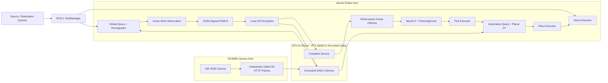

# Open-Vocabulary Robotic Tabletop Rearrangement

**开放词汇机械臂桌面整理系统 · Kinova Gen3 7DoF + Robotiq 2F-85**

An open-vocabulary tabletop manipulation system integrating global visual grounding,
active wrist-camera observation, local RGB-D perception, 6-DoF grasp candidates,
robot-aware feasibility checks, MoveIt 2, and ROS 2 task orchestration.

输入 **Source Object** 与 **Destination** 两个文本查询，系统在桌面内定位物体并完成抓取、放置和返回 HOME。

```text
HOME → Global Grounding → Active Observation → Local RGB-D
     → Grasp Candidates → Robot Feasibility → Pick
     → Destination Grounding → Place → [Coarse Verification] → HOME
```

## Overview

系统采用 **Global-to-Local Active Perception**：全局 HIK RGB 相机与 Grounded-SAM-2 完成语义搜索，通过桌面 Homography 得到目标的粗略 `base_link` XY；机械臂随后主动调整腕部 D435i 的观察位，利用对齐深度与目标分割生成局部目标点云和场景点云，再将 GraspNet 候选转换为机器人可执行的动作。

项目的工程重点是感知到动作的系统集成：图像空间一致性、SE(3) 坐标变换、夹爪与抓取中心几何、可达性和碰撞约束、ROS 2 异步编排、多机 HTTP 服务以及真实机器人执行。

## Key Features

- 开放词汇的源物体与目标容器检测、分割，过滤置信度不足或语义歧义的候选。
- 全局 RGB 粗定位与腕部主动观察，分离语义搜索和局部三维感知。
- RGB-D 有效深度筛选、目标/场景点云构建，以及 TF 到 `base_link` 的转换。
- GraspNet 6DoF 候选与机器人约束筛选，区分网络评分和机械臂可执行性。
- MoveIt 2 桌面碰撞场景、IK、OMPL 规划、Cartesian 接近与执行检查。
- ROS 2 Action 统一编排 HOME、感知、抓取、放置，提供进度反馈、失败阶段、执行锁和数据时效检查。
- RK3588 相机端、GPU 推理端和 Ubuntu 机器人主机分布式部署。

## System Architecture



| Hardware | Role |
|---|---|
| Kinova Gen3 7DoF + Robotiq 2F-85 | 机械臂与夹爪 |
| HIK RGB + RK3588 | 全局去畸变 RGB 与 HTTP 帧服务 |
| Intel RealSense D435i | 腕部 RGB-D 局部感知 |
| RTX A6000 | 实验中的远程模型推理平台，服务代码不强制限定该型号 |
| Ubuntu 机器人主机 | ROS 2 Humble、MoveIt 2、感知客户端与任务执行 |

## Perception and Grasp Planning

**全局感知：** `text_prompt → bbox / mask / primary_uv → Homography → coarse_base_xy`。接口严格检查 `UNDISTORTED_1280x720` 图像空间及分辨率。Homography 仅描述已标定平面，不能代替三维测量。

**主动观察与局部感知：** 全局位置生成多个观察位候选，通过 TF、观察方向验证与 MoveIt 规划选择观察轨迹。腕部 RGB、Aligned Depth 与上传图像的分割结果共同生成有效目标点、稠密场景点和相机/基座坐标下的质心。局部结果保存为 JSON 与 NPZ，供规划器读取。

**Robot-aware grasp filtering：** GraspNet 的 `translation / rotation / width / score` 并非直接执行指令。服务端先进行目标支持、碰撞和 NMS 筛选；机器人端再检查坐标与工具偏置、桌面间隙、碰撞感知 IK、单关节变化与关节 L1 成本、OMPL 到达 pregrasp，以及 Cartesian 接近比例。网络分数与运动成本共同参与选择。

观察位使用自定义 `observation_arm`（`joint_1` 到 `joint_6`），执行时保持当前第七关节并补齐完整轨迹。Pick/Place/Home 使用 `manipulator`。对应的 SRDF 和运动学配置需要在外部机器人工作空间中提供。

## ROS 2 Architecture

| Package / program | Responsibility |
|---|---|
| `open_vocab_interfaces` | `SceneObject.msg` 与 `Rearrange.action` |
| `open_vocab_observer` | JSON scene bridge、观察位生成、C++ MoveIt observer |
| `open_vocab_local_perception` | 腕部 RGB-D 分割、深度质量与点云输出 |
| `open_vocab_grasp_planner` | GraspNet HTTP 客户端、几何转换和候选可执行性检查 |
| `open_vocab_manipulation` | Pick/Place、夹爪、轨迹执行与日志 |
| `open_vocab_task_manager` | Action、任务状态机、HOME、CLI、超时和取消处理 |
| `perception/robot_host` | 全局开放词汇请求、候选选择、Homography 与 scene 文件 |

统一入口为 `/open_vocab/rearrange`，类型 `open_vocab_interfaces/action/Rearrange`：

| Part | Fields |
|---|---|
| Goal | `source_query`, `destination_query`, `verify_place`, `use_pick_dry_run` |
| Feedback | `task_id`, `state`, `progress`, `message`, `elapsed_s` |
| Result | `success`, `task_id`, `final_state`, `failure_stage`, `message`, `total_time_s` |

详细接口、任务状态机及八个配置 launch 参数见 [ros2_ws/README.md](ros2_ws/README.md)。Action 支持取消；当前 CLI 的 Ctrl-C 只退出客户端，不会发送 Action cancel。观察位执行的取消没有纳入 TaskManager 的统一 abort 链。

## Repository Structure

```text
.
├── README.md
├── LICENSE                         # 既有包许可与整库授权范围说明
├── ros2_ws/
│   └── src/                        # 六个 open_vocab_* ROS 2 包
├── perception/robot_host/           # 全局感知 CLI 与 Homography
├── ai_services/
│   ├── grounded_sam2_adapter/       # Grounded-SAM-2 HTTP 适配层
│   └── graspnet_adapter/            # GraspNet NPZ 服务与调试工具
├── rk3588_camera_service/           # OpenCV 相机、去畸变、HTTP 帧服务
├── config/
│   ├── example.yaml                # 部署参数模板
│   └── handeye_example.yaml         # 不含伪造标定值的手眼 TF 模板
├── scripts/                        # 配置生成、启动与只读检查
├── tests/                          # 无硬件配置一致性测试
├── docs/                           # 标定、运行边界和视频展示建议
├── third_party/README.md            # 外部来源与许可证
└── .github/workflows/               # 源码/配置检查，不执行机器人
```

原始源码的包内路径保持不变；历史机器人主机目录统一为 `perception/robot_host`。权重、现场标定、HOME 状态、视频、缓存和输出文件均不入库。

## Installation

目标机器人环境为 Ubuntu 22.04 / ROS 2 Humble / MoveIt 2。Windows 可以查看和运行仓库静态检查，不能据此验证机器人运行。

先按 [Kinova 官方 ROS 2 驱动说明](https://github.com/Kinovarobotics/ros2_kortex) 与 [RealSense 官方 ROS 2 Wrapper](https://github.com/realsenseai/realsense-ros) 准备外部硬件工作空间。**本仓库不包含完整 Kinova driver、URDF/SRDF、自定义 `observation_arm`、相机挂载或 MoveIt 配置。** 此外必须向 MoveIt 提供当前机器人描述、运动学/规划组配置及所需服务。

在仓库根目录执行，先 source 已安装且编译完成的外部机器人工作空间，再构建本仓库：

```bash
source /opt/ros/humble/setup.bash
# source <YOUR_EXTERNAL_KORTEX_WS>/install/setup.bash

python3 -m pip install -r perception/robot_host/requirements.txt
python3 -m pip install -r ros2_ws/src/open_vocab_local_perception/requirements.txt

cd ros2_ws
rosdep install --from-paths src --ignore-src -r -y
colcon build --symlink-install
source install/setup.bash
cd ..
```

GPU 服务的 requirements 文件是**适配层增量依赖**。先按上游说明安装 Grounded-SAM-2 / GraspNet 及其 CUDA 扩展、PyTorch 和模型权重，再安装服务依赖；不要假设 `pip install` 一个文件即可完整部署。入口和接口见 [Grounded-SAM-2 adapter](ai_services/grounded_sam2_adapter/README.md)、[GraspNet adapter](ai_services/graspnet_adapter/README.md) 与 [third_party/README.md](third_party/README.md)。

## Configuration

每台机器在**自己的 checkout** 中生成本地配置，不能直接复制另一台机器的绝对路径：

```bash
cp config/example.yaml config/site.local.yaml
# 编辑服务地址、外部模型路径、相机设备及测量值
python3 scripts/configure.py --site config/site.local.yaml
```

脚本生成 `config/local/` 下的 12 份 YAML：七份 ROS 节点配置、容器几何策略、全局感知、Grounded-SAM-2、GraspNet 和相机配置。生成路径使用当前 checkout 的绝对路径；配置中的主机名需要替换成实际可访问的地址。

- `homography_configured=false` 默认拒绝未标定的全局定位，需提供自己测量的 `.npy`。
- `geometry_confirmed=false` 默认拒绝观察位几何；确认后必须提供测量的 `table_z_m`。脚本同步观察、局部感知、抓取和 HOME 的桌面高度。
- 手眼 TF 必须单独测量，并由 `config/handeye.local.yaml` 发布；脚本不生成标定值。
- 包内桌面尺寸、TCP/抓取中心距离、容器高度与 XY 偏置保留为开发环境**示例**，需要在生成的 ROS YAML 中逐项现场校验。重新运行配置脚本会覆盖生成文件，定制长期参数可修改对应模板后再生成。
- 所有生成配置默认关闭真实执行。它们不会验证硬件、下载模型或开启运动。

详见 [docs/calibration.md](docs/calibration.md)。`config/local/`、`*.local.yaml`、模型及现场标定均已加入 `.gitignore`。

## Usage

以下命令在仓库根目录执行，硬件与 ROS 环境需先就绪。分布式服务分别在对应机器的 checkout 中运行。

### 1. Robot / MoveIt bringup

以下是外部 Kinova 包的标准入口，依据本机已校验版本使用；它本身不补齐本项目所需的自定义观察规划组和相机挂载配置：

```bash
ros2 launch kinova_gen3_7dof_robotiq_2f_85_moveit_config robot.launch.py \
  robot_ip:=<KINOVA_IP>
```

### 2. Wrist RGB-D and calibrated TF

使用 `/camera/camera/...` 的 topic 命名，与仓库的 local perception 配置一致：

```bash
ros2 launch realsense2_camera rs_launch.py \
  camera_namespace:=camera camera_name:=camera \
  publish_tf:=false align_depth.enable:=true enable_color:=true enable_depth:=true
```

在另一个终端发布实际测得的 wrist → color optical TF。如果机器人描述已提供该变换，保留一个发布源即可：

```bash
cp config/handeye_example.yaml config/handeye.local.yaml
# 完成测量，填写平移和 xyzw 四元数，并设置 calibrated: true
python3 scripts/publish_handeye.py config/handeye.local.yaml
```

### 3. RK3588 and GPU services

RK3588 上安装相机服务依赖，提供自己的相机内参文件并启动：

```bash
python3 -m pip install -r rk3588_camera_service/requirements.txt
bash rk3588_camera_service/run.sh "$PWD/config/local/camera.yaml"
```

GPU 端已安装上游模型环境后，在不同终端分别启动：

```bash
bash ai_services/grounded_sam2_adapter/run.sh "$PWD/config/local/grounded_sam2.yaml"
bash ai_services/graspnet_adapter/run_grasp_service.sh "$PWD/config/local/graspnet.yaml"
```

默认端口分别为 `8080 / 8090 / 8091`。服务 `/health` 可用于连通检查；模型路径、校准与请求成功需要单独验证。当前相机文件仅提供单帧图像和元数据，不含原生 MJPEG endpoint。

### 4. Locked system startup and HOME setup

```bash
source ros2_ws/install/setup.bash
bash scripts/launch_system.sh enable_real_execution:=false
```

这是**锁定执行的节点启动**，用于检查节点、参数、TF 与服务，完整 rearrangement Action 会被 preflight 拒绝。它不是可跑完任务的仿真模式。PlaceExecutor 在初始化时就会加载真实 Homography 文件，即使关闭执行也一样；默认未标定模板不能使全部节点就绪，先提供自己的 `H.npy` 再进行完整节点检查。

将机器人通过已验证的控制方式移动到安全 HOME，再记录当前七关节姿态：

```bash
ros2 service call /open_vocab/home/capture_current std_srvs/srv/Trigger '{}'
```

HOME 状态在本地生成，仓库不分发作者的实机姿态。

### 5. Real execution

完成 [Safety Notice](#safety-notice) 中的现场验证，停止先前锁定的本项目 launch，再显式启用：

```bash
bash scripts/launch_system.sh enable_real_execution:=true
```

在另一个已 source 环境的终端提交任务：

```bash
ros2 run open_vocab_task_manager rearrange_cli banana "glass bowl"
ros2 run open_vocab_task_manager rearrange_cli "white car" "cardboard box"
ros2 run open_vocab_task_manager rearrange_cli "blue stapler" "cardboard box" --verify
```

CLI 默认开启 `use_pick_dry_run`。代码中的 `approach_dry_run` **会执行机械臂 Cartesian 接近，并可打开夹爪**；这个名称不能理解为无运动模拟。`--verify` 为可选粗粒度视觉检查，不代表可靠的容器内放置成功判定。

## Example Tasks and Demo Status

作者在真实机器人上测试的任务包括以下三类，物体位置可以在运行之间重新布置。当前未提供统一测试次数、成功率、耗时统计或公开的视频证据，暂不报告性能指标。

| Source query | Destination query |
|---|---|
| `banana` | `glass bowl` |
| `white car` | `cardboard box` |
| `blue stapler` | `cardboard box` |

测试范围是已标定工作空间与上述硬件下的桌面单任务整理。容器的放置几何仍需人工配置。

## Web Dashboard

作者的演示系统使用 Web UI 提交源/目标查询、显示全局 RGB、分割、任务进度并通过 Action 与 TaskManager 交互。**`open_vocab_web_ui` 源码未在本次文件中找到，因此这里不提供其安装命令，也不将其列为当前仓库可复现模块。** 原生低码率 MJPEG 预览与机器人主机代理同样待补充；当前 RK3588 服务保留 1280×720 感知用单帧接口。

## Known Limitations

- 检测与分割可能混淆相似物体；输入是源/目标查询，没有 VLM/VLA 任务规划或自由指令解析。
- 全局定位和容器 XY 依赖平面 Homography；不能推断任意物体或容器的三维几何。
- 未指定的容器沿用 `place.yaml` 的启动几何；不同高度/形状必须测量并提供 override。
- `--verify` 仅比较源与目标的平面质心距离，不验证 mask 包含关系或可靠抓取成功。
- 当前静态演示关闭接近后的源重验证，夹爪接触证据也不是强制成功门槛。
- 未实现被夹持物体的 attached collision geometry；桌面碰撞模型不等同于完整动态场景。
- 取消为 best-effort；CLI Ctrl-C 不发送 cancel，TaskManager abort 不覆盖独立 observer 轨迹。
- RGB-D 质量、透明/反光表面、远程模型响应和网络时延影响结果。
- 外部依赖版本未锁定；缺少作者实际使用的完整机器人配置。发布副本需在目标系统构建与重新验证。

## Safety Notice

This project controls a real robotic manipulator. Before enabling real execution, validate robot calibration, TF transforms, tool center point, planning scene, workspace boundaries, table height, grasp offsets, container geometry, joint limits, and gripper control. Inspect plans in RViz and validate each execution stage with the actual hardware.

Software cancellation is **not a replacement for the physical emergency stop**. 默认执行锁只控制本项目节点，不约束其他机器人控制程序，也不构成安全认证。

## Validation

无需机器人、GPU 或相机即可运行：

```bash
python3 -m pip install PyYAML
python3 scripts/check_repository.py
python3 -m unittest discover -s tests -v
```

这些检查覆盖 Python 3.10 语法兼容、YAML/XML 解析、本地配置路径一致性、共同桌面高度、默认执行锁以及手眼参数校验。它们不验证 C++/ROS 2 构建、模型推理、规划成功或真实机器人行为。CI 也只执行以上静态/配置检查。

## Third-party Models and License

Grounded-SAM-2 and GraspNet are third-party models. Follow their original licenses and installation instructions. No upstream model repository, checkpoint, dataset, robot-driver repository, or Docker image is bundled here. See [third_party/README.md](third_party/README.md), including GraspNet baseline's noncommercial research terms.
